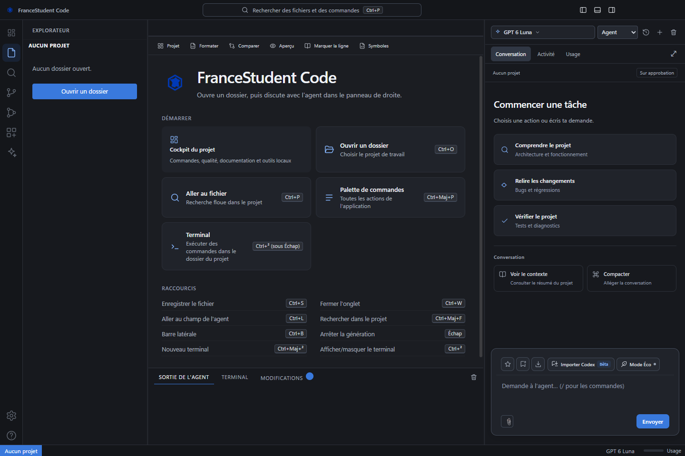
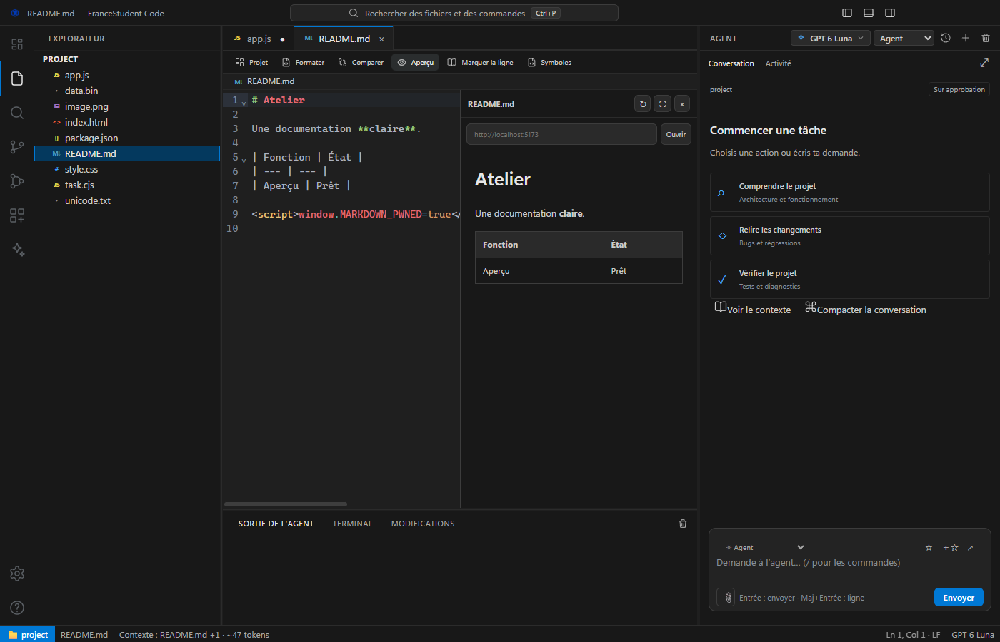
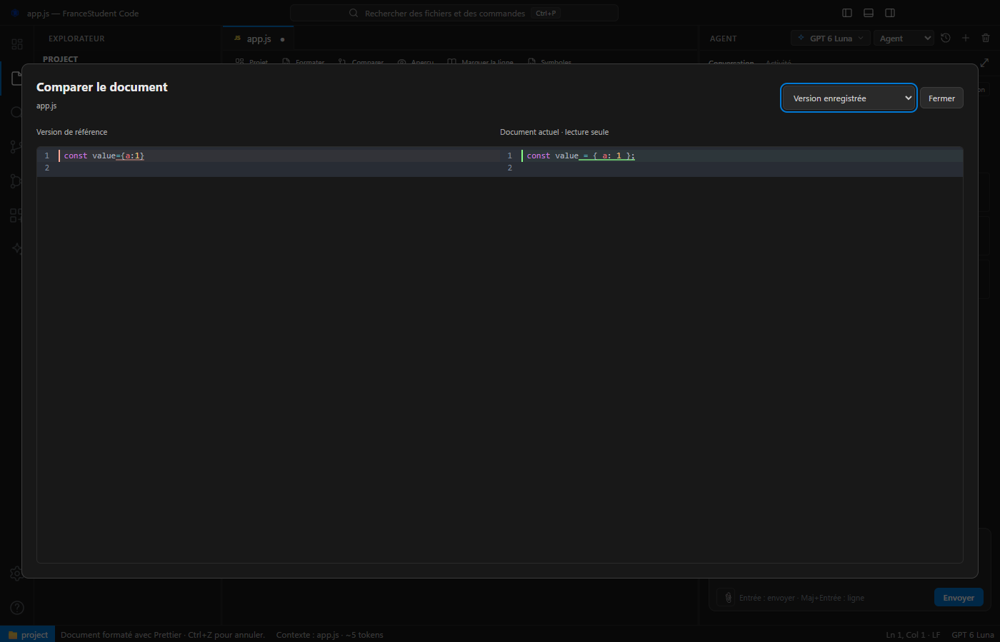

<div align="center">


# FranceStudent IDE

**Un espace pour coder, piloter son agent et suivre son projet.**

Fork amélioré · Interface en français · Windows x64

[](https://github.com/extraopaa/francestudents-ide/releases/latest)
[](https://github.com/extraopaa/francestudents-ide/releases/latest)
[](https://github.com/EsteG7/francestudents-ide)

[Télécharger](https://github.com/extraopaa/francestudents-ide/releases/latest) · [Guide](docs/guide-utilisation.md) · [Nouveautés](CHANGELOG.md) · [Projet original](https://github.com/EsteG7/francestudents-ide)

</div>

> [!IMPORTANT]
> **FranceStudent IDE est un projet de [EsteG7](https://github.com/EsteG7).** Ce dépôt est uniquement un **fork d’amélioration**, maintenu par [extraopaa](https://github.com/extraopaa). Il prolonge le travail d’origine avec des fonctionnalités et des améliorations d’interface. Le crédit de la création revient à EsteG7 et aux contributeurs du [dépôt original](https://github.com/EsteG7/francestudents-ide).



## Télécharger et démarrer

Version **1.1.1 pour Windows x64**. Aucun Node.js ni npm n’est nécessaire pour utiliser les exécutables.

| Version | Usage | Téléchargement |
| --- | --- | --- |
| **Installateur** | Installation classique et prise en charge des futures mises à jour | [Setup Windows](https://github.com/extraopaa/francestudents-ide/releases/download/v1.1.1/FranceStudentCode-1.1.1-setup.exe) |
1. Ferme une ancienne version éventuelle, puis lance le setup ou le portable.
2. Suis le guide avec ton **compte FranceStudent**. Aucune clé API n’est demandée pour le chat.
3. Ouvre ton dossier de projet et décris ce que tu veux réaliser.

Le compte et les limites d’utilisation de FranceStudent restent nécessaires. Les exécutables ne disposent pas d’une signature d’éditeur reconnue ; Windows peut afficher un avertissement. Les empreintes SHA-256 sont fournies dans la release.

## Un agent intégré à ton travail

| Espace | Fonctionnalités |
| --- | --- |
| **Agent** | Conversation, activité, plan de travail, mode Plan sans modification et arrêt des tâches |
| **Demandes en continu** | Entrée pendant une tâche empile les prompts au-dessus de la saisie ; édition, suppression, ordre et **Orienter** |
| **Contexte** | Instructions `AGENTS.md`, fichiers ouverts, budgets réglables et compaction automatique |
| **Éditeur** | Onglets, recherche, symboles, diagnostics JS/TS, Prettier et comparaison |
| **Cockpit** | Scripts, commandes personnalisées, sorties en direct, arrêt, relance et diagnostics |
| **Web** | Recherche autonome ou en arrière-plan, lecture de sources et captures de pages |
| **Extensions** | Skills embarqués, profils, import de `SKILL.md`, SkillsMP et serveurs MCP stdio |
| **Confort** | Paramètres recherchables, thèmes, favoris, brouillons et export Markdown |
| **Fichiers** | Texte UTF-8/UTF-16, aperçus d’images et médias, inspection des autres formats |
| **Compte** | Guide de connexion, déconnexion et conservation des fichiers et conversations |

L’éditeur, le terminal intégré et les vues Git du projet original restent le socle de cette version. Le [changelog](CHANGELOG.md) décrit les améliorations regroupées dans ce fork.

### Une conversation qui continue

À l’approche du budget de contexte, l’agent résume les échanges et reprend automatiquement sa tâche dans une nouvelle conversation serveur. Les consignes, décisions, fichiers et actions restantes servent de relais ; le fil affiché et les prompts en attente restent visibles.

Le seuil repose sur une estimation prudente : le service ne fournit pas la fenêtre exacte de chaque modèle. Une erreur explicite de contexte trop long déclenche aussi une tentative de compaction. La lecture d’images dépend du modèle sélectionné. [Détails et limites](docs/studio.md).

### Un espace de travail cohérent

<details>
<summary><strong>Aperçu Markdown et comparaison de code</strong></summary>





Captures réalisées sur un projet de démonstration.

</details>

## Choisir son niveau d’autonomie

Choisis **Demander** pour garder les confirmations, ou configure les autorisations dans les paramètres.

> [!WARNING]
> **Full accès permet d’agir sans confirmation** : écriture ou suppression de fichiers, commandes PowerShell et transmission de données sur Internet, parfois hors du projet. Active ce mode uniquement avec des projets et outils de confiance. Il utilise les droits du compte qui lance l’application, sans accorder automatiquement les droits administrateur.

Les permissions de capture sont réglables séparément. Un serveur MCP lance un programme local ; un skill apporte des instructions : examine leur contenu avant activation.

## Documentation

- [Guide d’utilisation complet](docs/guide-utilisation.md) — connexion, interface, commandes et raccourcis.
- [Cockpit, formats, contexte et mises à jour](docs/studio.md).
- [Intégration GitHub](docs/github.md).
- [Changelog](CHANGELOG.md) · [Crédits](CREDITS.md) · [Contribuer](CONTRIBUTING.md).

## Développer à partir des sources

Prérequis : **Node.js 22+**, npm et Git. Les scripts nécessitent leurs propres outils installés.

```powershell
git clone https://github.com/extraopaa/francestudents-ide.git
cd francestudents-ide
npm install
npm run desktop
```

| Commande | Usage |
| --- | --- |
| `npm run desktop` | Reconstruire l’interface et lancer l’application |
| `npm run lint` | Vérifier le code |
| `npm test` | Exécuter les tests unitaires |
| `npm run test:e2e` | Vérifier les parcours Electron |
| `npm run dist:win` | Générer le portable et l’installateur Windows |
| `npm run dist:mac` | Construire pour macOS Intel depuis un environnement adapté |

Cette release distribue uniquement les exécutables Windows x64 vérifiés. Aucun build macOS n’est fourni dans cette release.

## Origine et crédits

**Projet original : [EsteG7/francestudents-ide](https://github.com/EsteG7/francestudents-ide), créé par EsteG7.** Merci pour le travail qui rend ce fork possible. Les améliorations sont maintenues par **extraopaa** ; elles ne remplacent pas l’attribution d’origine et ne constituent pas une version officielle du dépôt amont.

Le champ `author` historique du paquet (**Hecone**) est conservé. Le `package.json` déclare ISC ; aucun fichier `LICENSE` autonome n’est actuellement présent. Ce fork ne réattribue pas les droits du projet d’origine. Les composants tiers conservent leurs licences, consultables dans l’application et dans le [guide](docs/studio.md#composants-open-source).
